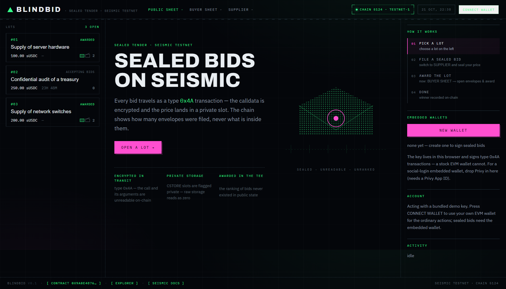
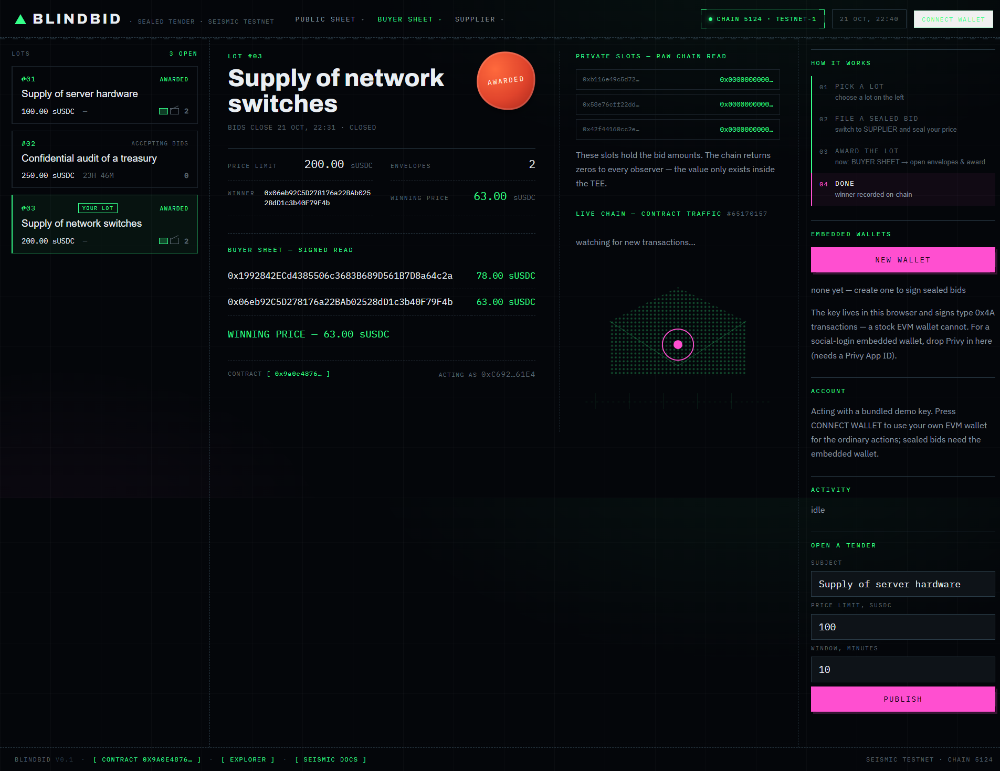
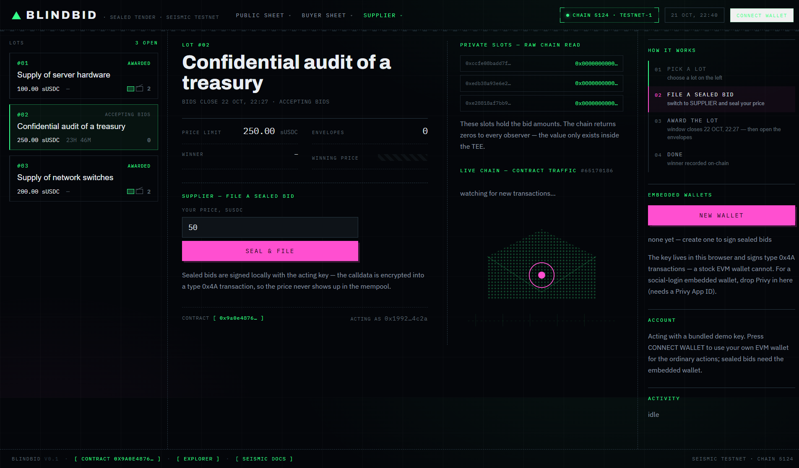

# BlindBid — sealed bids on Seismic

A tender where **the bid amount never appears in public state and never appears in the transaction**.

The calldata is encrypted (transaction type `0x4A`), the price lands in a private storage slot, and the
winner is computed **inside the TEE** — only the winning slot leaves the enclave. Not just the amounts:
the *ranking* of the bids never existed publicly either.

Two builds of the same contract, both deployed on the Seismic testnet:

| Build | Compiler | Private storage | Contract |
|---|---|---|---|
| **shielded** (primary) | [`ssolc`](https://github.com/SeismicSystems/seismic-solidity) — Seismic's own compiler | `suint256` — the compiler emits `CSTORE`/`CLOAD` itself | [`0x9a0e48764f7e761cc8dfd99e82e239031ec13a10`](https://seismic-testnet.socialscan.io/address/0x9a0e48764f7e761cc8dfd99e82e239031ec13a10) |
| **portable** | stock `solc` | a small Yul library (`SealStore.yul`) that injects `CSTORE` via `verbatim` | [`0xd9191d5f065a44778890de4e80c57fc2b1237ec4`](https://seismic-testnet.socialscan.io/address/0xd9191d5f065a44778890de4e80c57fc2b1237ec4) |

The portable build exists only because Seismic ships no Windows binary of its own compiler — the shielded
build is the native path and needs nothing but `ssolc` (it has a Windows release).

Seismic testnet · chain **5124** · **17/17 checks passing** against the shielded deployment.



---

## The three layers

| Layer | What an observer sees |
|---|---|
| **Transaction** | "someone called a function on `0x9a0e…1a10`" — not which function, not the arguments (type `0x4A`) |
| **State** | `eth_getStorageAt` → `0x0000…0000` for every bid slot |
| **Comparison** | the winner only — the ordering was computed inside the enclave and never left it |


---

## Live deployment

| Contract | Address | Build |
|---|---|---|
| `BlindBid` | [`0x9a0e48764f7e761cc8dfd99e82e239031ec13a10`](https://seismic-testnet.socialscan.io/address/0x9a0e48764f7e761cc8dfd99e82e239031ec13a10) | shielded (`suint256`) |
| `BlindBid` (portable) | [`0xd9191d5f065a44778890de4e80c57fc2b1237ec4`](https://seismic-testnet.socialscan.io/address/0xd9191d5f065a44778890de4e80c57fc2b1237ec4) | portable (`solc` + `SealStore.yul`) |
| `SealStore` (private storage lib, portable build) | [`0x427b3bc3a4fae1862ca380ffba35b349e7f91e85`](https://seismic-testnet.socialscan.io/address/0x427b3bc3a4fae1862ca380ffba35b349e7f91e85) | Yul |

RPC: `https://testnet-3.seismictest.net/rpc` · gas token: **sUSDC** (6 decimals, no native ETH).

### What is on chain right now (shielded build)

| Lot | Subject | Envelopes | State | Buyer |
|---|---|---|---|---|
| #01 | Supply of server hardware | 2 | **AWARDED** — winner bid 12.00 sUSDC of 50 / 12 | deployer |
| #02 | Confidential audit of a treasury | 0 | **ACCEPTING BIDS** — sealed price, the winning price is never published | deployer |
| #03 | Supply of network switches | 2 | **AWARDED** — 63.00 sUSDC | demo buyer |

The portable build carries five more lots, including one with four envelopes and a sealed price.

---

## Screenshots

**Buyer sheet — signed read.** The raw slots on the right read as zeros for everyone; the buyer sees the
amounts because `msg.sender` is recovered from a signature.



**Supplier sheet — filing a sealed bid.** The price is sealed client-side and sent as a type `0x4A`
transaction.




---

## Try it in five minutes

```bash
git clone https://github.com/Juniorj87/blind-bid.git
cd blind-bid
npm install

# 1. your key + a funded testnet account (see "Wallets and gas" below)
echo "MAIN_PK=0x..." > .env

# 2. the Seismic compiler (only needed for the shielded build)
curl -L -o ssolc.zip https://github.com/SeismicSystems/seismic-solidity/releases/download/2ebb36d/ssolc-windows-x86_64.zip
unzip ssolc.zip -d tools/ssolc

# 3. build + deploy + demo data
SSOLC=tools/ssolc/solc.exe npm run build:shielded
npm run seed

# 4. read-only self-test against your deployment (no gas needed)
npm test

# 5. the front end
npm run writer    # local signer  → http://127.0.0.1:4181
npm run web       # showcase      → http://localhost:5173
```

### Scripts

| Command | What it does |
|---|---|
| `npm run build:shielded` | compiles the native build with `ssolc` → `artifacts-shielded.json` |
| `npm run build` | compiles the portable build with stock `solc` → `artifacts.json` |
| `npm run deploy` | deploys the portable build |
| `npm run seed` | deploys the portable build + demo data + funds the demo accounts |
| `npm run seed:shielded` | deploys the shielded build + demo lots (sealed bids, award) |
| `npm test` | 17 read-only checks (network, contract, privacy, award, aggregates) |
| `npm run test:scan` | additionally scans recent blocks and asserts the bid transactions are type `0x4A` |
| `npm run report` | regenerates `TEST-REPORT.md` |
| `npm run writer` | local signer for the front end (`127.0.0.1:4181`) |
| `npm run web` | the front end |
| `npm run demo` | end-to-end scenario in one process: tender → 3 bids → award → all three views |

---

## How the privacy works

```
supplier                    BlindBid contract                    observer
    │                              │                                  │
    │  submitBid(amount)           │                                  │
    ├──── tx type 0x4A ───────────►│ calldata encrypted client-side    │
    │                              │                                  │
    │                              │──► CSTORE → slot flagged private, │
    │                              │    raw storage reads as zero       │
    │                              │                                  │
    │                 closeAndAward│                                  │
    │                              │──► min over private slots:        │
    │                              │    comparison inside the TEE,     │
    │                              │    only the winning slot leaves   │
    │                              │──► winner address                  │
```

1. **Transaction.** `shieldedWriteContract` produces type `0x4A`. The calldata is encrypted to the node's
   public key before it is signed, so the explorer shows an opaque blob.
2. **State.** The amount is a `suint256` in the shielded build — the compiler emits `CSTORE`/`CLOAD` and
   flags the slot private by itself. The portable build reaches the same state through a Yul library that
   injects `CSTORE` (`0xB1`) via `verbatim`. Either way a raw `eth_getStorageAt` returns zeros — visible in
   the screenshot above and in `TEST-REPORT.md`.
3. **Comparison.** The winner is found by comparing private values *inside* the enclave, so even the order
   of the bids was never public. The buyer still gets what an auditor needs: every amount (signed read)
   and the **aggregate** (`totalCommitted`) — the sum, without any single bid.

### Why two builds

- **Shielded (`suint256`)** is the native path: it needs only Seismic's compiler, and the private slot is
  one keyword. This is what a Seismic project should look like.
- **Portable (`solc` + Yul)** exists because `sforge`/`ssolc` have no Windows build in some setups and
  because it is a useful reference for what `CSTORE` actually does. It is one step removed from the
  idiomatic form and is kept as a second, independently deployed instance.

The private-slot library is called with an ordinary `call`/`staticcall`, **not** `delegatecall`: `CLOAD`
inside a delegatecall does not work in the `eth_call`/static context the node uses to simulate.

---

## Tests

```bash
npm test           # 17 checks, no gas
npm run report     # regenerates TEST-REPORT.md
```

`TEST-REPORT.md` is the generated artifact: addresses, the full self-test output, the on-chain state of
every lot, the **raw private-slot reads** (all zeros) and the **buyer-only signed-read table**.

The checks are not cosmetic — they assert the thesis:

```
  lot #0  "Supply of server hardware"  bids=2  status=1
  PASS  private slots read as zero for an outside observer  — 0x0000 0x0000
  PASS  winner is set  — 0x9D3E6620ea0f85C73eF118504159558F41A0ffe7
  PASS  winning amount is published  — 12 sUSDC
  PASS  winner holds the lowest bid  — min=12
  PASS  aggregate matches the sum of bids  — 62 sUSDC
  PASS  winner appears in the bid list  — index 1
```

There are no Solidity unit tests yet: `sforge` has no Windows build, so the suite is written as end-to-end
scenarios against a live deployment (`scripts/selftest.mjs`, `scripts/demo.mjs`).

---

## Wallets and gas

Everything below is **testnet only**. No mainnet asset, no value, no third-party funds.

| Role | Address | Key |
|---|---|---|
| Deployer — owner of lots #01, #02 | `0x424fF7f4A7CBB654E5168829C8535be3C0ef2e6c` | burner, kept outside the repo in `.env` as `MAIN_PK` |
| Demo buyer — owner of lot #03 | `0xC692DeD9eEdf80436877f2A6B022ac9E3CB561E4` | **public** in `web/src/demo-accounts.ts` |
| Demo supplier | `0x1992842ECd4385506c3683B689D561B7D8a64c2a` | **public** in `web/src/demo-accounts.ts` |
| Demo supplier B | `0x06eb92C5D278176a22BAb02528dD1c3b40F79F4b` | **public** in `web/src/demo-accounts.ts` |

The three demo keys are published on purpose: they are burners that hold test sUSDC only, so anyone can
reproduce the demo without touching a real wallet. The deployer key is **not** in this repository — set
your own `MAIN_PK` and the scripts use yours.

**Where the gas came from.** The official faucet (<https://faucet.seismictest.net>) grants 10 sUSDC per
GitHub account per 24 h. The deployer account was topped up there on 2026-10-21 (~17:00 UTC). A sealed
bid is a type `0x4A` transaction and costs ≈ **0.07 sUSDC**; a plain transaction ≈ 0.003 sUSDC.

**The faucet is currently broken for everyone** (RFC 9207: GitHub added an `iss` parameter to the OAuth
callback and `next-auth@4.24.11` rejects it). The workaround is to replay the callback URL without
`iss` — see *Known limitations*.

---

## Why this, and not another auction

Sealed-bid auctions exist on other chains — Arcium, Inco, Zama, Midnight, Story — but only as ★0–5 hobby
repos about NFTs, freelance work, agriculture or data marketplaces, and **none of them on Seismic**
(0 of 37 third-party repos in the ecosystem). Three things are different here:

1. **The award is computed in the shielded domain.** Elsewhere amounts are encrypted but the winner is
   computed off-chain or via commit–reveal. Here the comparison happens inside the TEE, so the ordering of
   the bids never existed publicly.
2. **It is a tender, not an auction.** Criteria, deadline, award notice, and an aggregate for the
   regulator. Seismic's testnet was built with local governments, and municipal procurement is sealed by
   law.
3. **The price can stay sealed after the award** (`sealedPrice`). In a normal auction the winning price
   is disclosed to everyone, otherwise it is not an auction; in compliance-grade procurement it does not
   have to be.

The point of the demo is not to farm transactions — it is to show that a *real* procurement workflow
runs end to end on Seismic privacy primitives, with the audit trail a regulator would ask for and without
exposing the commercial data of the bidders.

---

## The front end

One page, three sheets over the same lot:

- **public sheet** — envelope count, deadline, winner; amounts rendered as redactions; the raw private
  slots with the zeros the chain returns; live block counter and contract traffic.
- **buyer sheet** — signed read: every amount, the audit aggregate, and the award button.
- **supplier sheet** — file a sealed bid; the price is encrypted client-side.

`CONNECT WALLET` attaches an external EVM wallet for the ordinary actions. The app also keeps an
**embedded wallet** (the key is generated in the browser and stored in `localStorage`) because a stock
EVM wallet cannot sign type `0x4A` at all. For a social-login embedded wallet, drop Privy in here — it
needs a Privy App ID and a `@privy-io/react-auth` + wagmi + `seismic-react` setup, the same stack the
Seismic docs use.

### Why there is a local signer

The browser cannot produce a valid type `0x4A` payload — the node rejects it with *Error Decrypting in
Seismic EthApiExt* — while the identical call from Node signs and broadcasts correctly. The front end
therefore hands the key to `scripts/writer.mjs` on `127.0.0.1:4181`, which builds and signs the sealed
transaction and returns the hash. The key never leaves localhost. Ordinary actions (opening a lot,
awarding) are signed in the browser as normal transactions.

---

## Layout

```
blind-bid/
├── contracts/
│   ├── BlindBidShielded.sol  # native build: suint256, compiled by ssolc
│   ├── BlindBid.sol          # portable build: plain Solidity + Yul library
│   └── SealStore.yul         # private storage: CLOAD/CSTORE, minSlot, sumSlots
├── scripts/
│   ├── build-shielded.mjs    # compile with ssolc → artifacts-shielded.json
│   ├── build.mjs             # compile with solc → artifacts.json
│   ├── deploy.mjs            # deploy the portable build
│   ├── seed-english.mjs      # deploy + demo data + fund the demo accounts
│   ├── seed-shielded.mjs     # deploy + demo lots for the shielded build
│   ├── selftest.mjs          # the checks → npm test
│   ├── report.mjs            # regenerates TEST-REPORT.md
│   ├── writer.mjs            # local signer for the front end
│   ├── fund-demo.mjs         # top up the demo accounts with gas
│   ├── finish-lot.mjs        # finish a lot after an RPC rate-limit interruption
│   └── demo.mjs              # end-to-end scenario in one process
├── web/                      # the front end (Vite + React)
├── docs/
│   ├── shots/                # screenshots
│   └── diagrams/             # SVG diagrams
├── artifacts.json            # portable build
├── artifacts-shielded.json   # shielded build
├── deployments.json
└── TEST-REPORT.md
```

---

## Known limitations

- The front end is client-only (no SSR) and has no server component — it is a demo, not a product.
- The sealed bid has to go through the local signer (see above). This is a client/library issue with the
  node's decryption path in the browser, not a property of Seismic.
- The amount is passed to the contract in an internal call — it is absent from the transaction, from state
  and from the explorer, and is only visible to someone tracing at `debug_traceTransaction` level.
- The winner and price are published at award (unless `sealedPrice` is set).
- The official faucet is broken for everyone (RFC 9207 `iss` parameter vs `next-auth@4.24.11`). Workaround:
  replay the OAuth callback URL without `iss`.
- Public testnet RPCs rate-limit aggressively (`429 Too Many Requests`); the scripts retry, but a demo
  that files many bids at once will feel it.
- No Solidity unit tests — `sforge` has no Windows build; the suite is end-to-end scenarios instead.

---

Built by [@Juniorj87](https://github.com/Juniorj87) on the Seismic testnet. Test sUSDC only.
